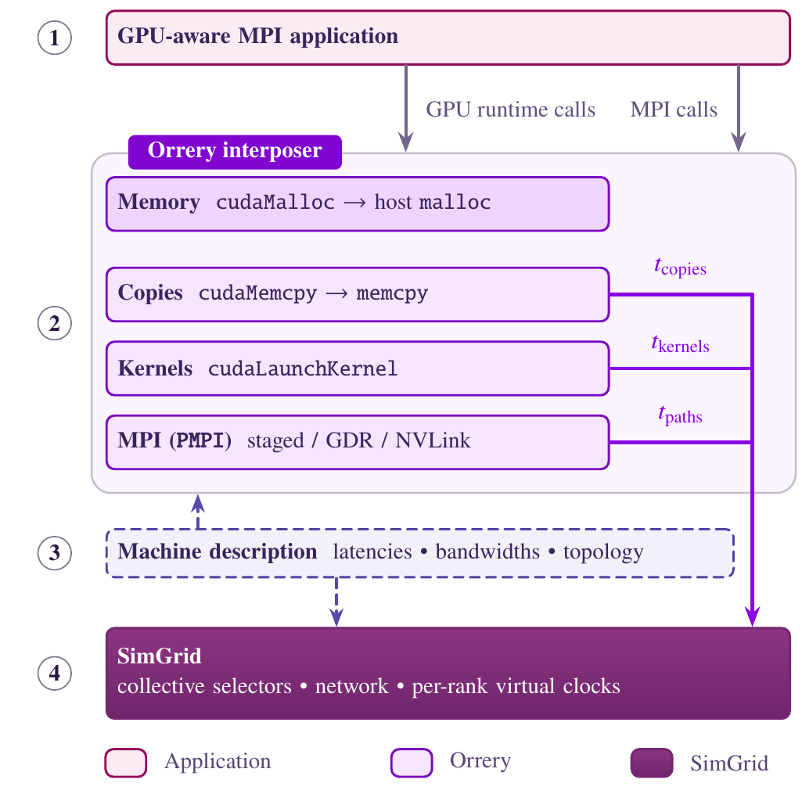

# Orrery

Orrery runs **unmodified CUDA-aware MPI applications** inside the
[SimGrid](https://simgrid.org) simulator. It is a thin interposition layer
that sits between the application and SimGrid's MPI implementation (SMPI):

  

## Citing

See [CITATION.cff](CITATION.cff).
